# 🎨 Stable Diffusion Artwork Fine-Tuning (LoRA & BLIP)

<p align="center">
  <strong>Domain-Specific Diffusion Model Fine-Tuning using Low-Rank Adaptation (LoRA), BLIP Automated Captioning, and PyTorch Diffusers.</strong>
</p>

<p align="center">
  <a href="https://github.com/lithik-raj/Stable-Diffusion-Artwork-Fine-Tuning"></a>
  <a href="https://vercel.com/new/clone?repository-url=https://github.com/lithik-raj/Stable-Diffusion-Artwork-Fine-Tuning"></a>
  <a href="https://stable-diffusion-artwork-fine-tuning-lithik-raj.vercel.app"></a>
  
</p>

<p align="center">
  
  
  
  
  
</p>

---

## 📌 Live Deployments & Quick Links

| Resource | Direct Link | Description |
|---|---|---|
| 🐙 **GitHub Repository** | [github.com/lithik-raj/Stable-Diffusion-Artwork-Fine-Tuning](https://github.com/lithik-raj/Stable-Diffusion-Artwork-Fine-Tuning) | Notebooks, weights, and artwork generator |
| ⚡ **Vercel 1-Click Deploy** | [Deploy to Vercel](https://vercel.com/new/clone?repository-url=https://github.com/lithik-raj/Stable-Diffusion-Artwork-Fine-Tuning) | Instant cloud web deployment |
| 🌐 **Vercel Live Application** | [stable-diffusion-artwork-fine-tuning-lithik-raj.vercel.app](https://stable-diffusion-artwork-fine-tuning-lithik-raj.vercel.app) | Live interactive artwork studio & gallery |

---

## 📖 Executive Summary

Base foundational latent diffusion models (such as vanilla Stable Diffusion v1.5) produce photorealistic imagery across generic domains, but often fail to faithfully reproduce distinct, high-fidelity fine art styles, painterly brushstrokes, dynamic impasto, and specialized color palettes.

This project delivers an end-to-end **Generative AI pipeline** that adapts **Stable Diffusion v1.5** to a curated artistic domain using **Low-Rank Adaptation (LoRA)** and **BLIP (Bootstrapping Language-Image Pre-training)** captioning. By freezing base transformer attention weights and updating low-rank decomposition matrices ($r=8, \alpha=16$), the training pipeline achieves fast convergence and style fidelity on consumer GPU hardware.

---

## 🧠 Architecture & Methodology

```mermaid
flowchart LR
    Dataset["Raw Artwork Images"] --> BLIP["BLIP Vision-Language Model\n(Automated Captioning)"]
    BLIP --> Pairs["(Image, Text Prompt) Pairs"]
    Pairs --> Tokenizer["CLIP Tokenizer\n(Text Embeddings)"]
    Tokenizer --> UNet["UNet Cross-Attention Layers\n(Frozen Base Weights)"]
    UNet --> LoRA["LoRA Injected Adapters\n(Rank r=8, Alpha=16)"]
    LoRA --> Loss["Noise Prediction Loss\n(MSE / AdamW Optimizer)"]
    Loss --> Sampler["DPMSolverMultistep Sampling"]
    Sampler --> Output["High-Resolution Artwork Canvas"]
```



---

## 🖼️ Sample Outputs

| Sample Output 1 | Sample Output 2 |
|:---:|:---:|
| .png) | .png) |
| *Prompt: Ethereal celestial artwork with brushstroke adaptation* | *Prompt: Mystic vibrant landscape with cross-attention LoRA* |

---

## 🚀 Execution & Colab Reproduction

1. Open `Stable_Diffusion_Artwork_FineTuning.ipynb` in [Google Colab](https://colab.research.google.com).
2. Set hardware runtime to **GPU (T4 / A100)**.
3. Install required libraries:
   ```bash
   pip install -r requirements.txt
   ```
4. Run all cells to execute BLIP captioning, LoRA rank injection, and fine-tuning.

---

## ☁️ Vercel Web Deployment

This repository includes a standalone **Interactive Artwork Studio** built in HTML5/CSS3 and configured with `vercel.json` for zero-configuration, instant Vercel deployment.

1. Open **[vercel.com/new](https://vercel.com/new)**
2. Import `Stable-Diffusion-Artwork-Fine-Tuning`
3. Click **Deploy**!

---

## 📄 License & Author

- **Author**: [Lithik Raj](https://github.com/lithik-raj)
- **License**: [MIT](LICENSE)
